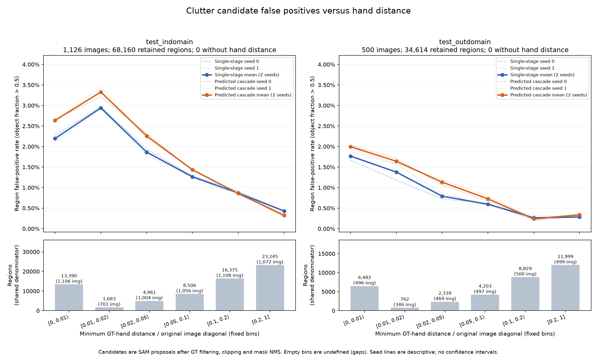
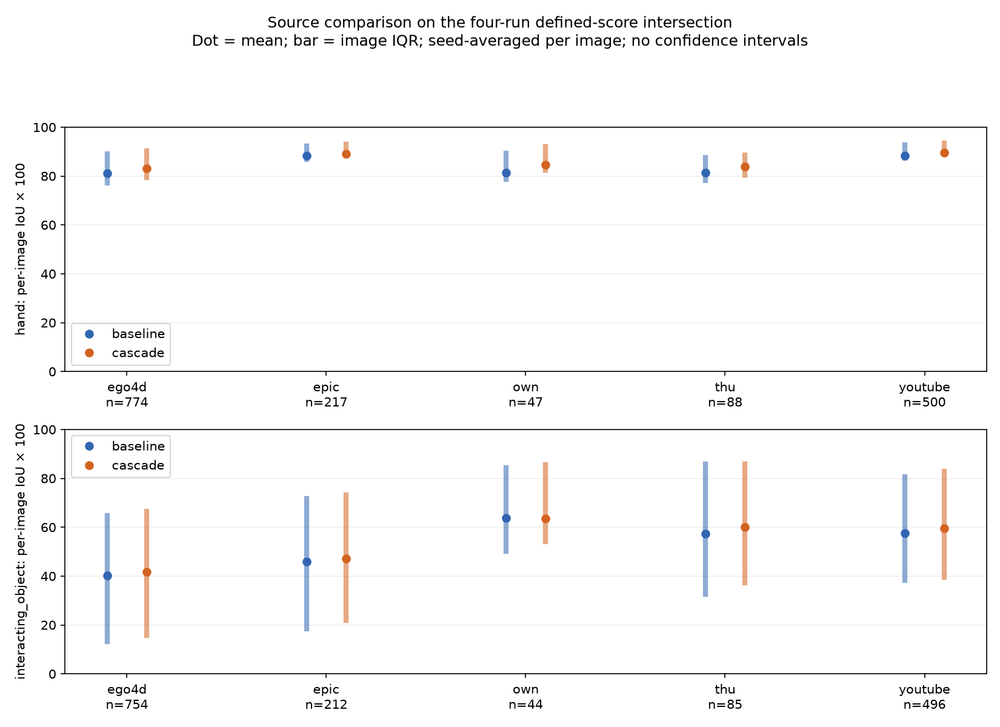
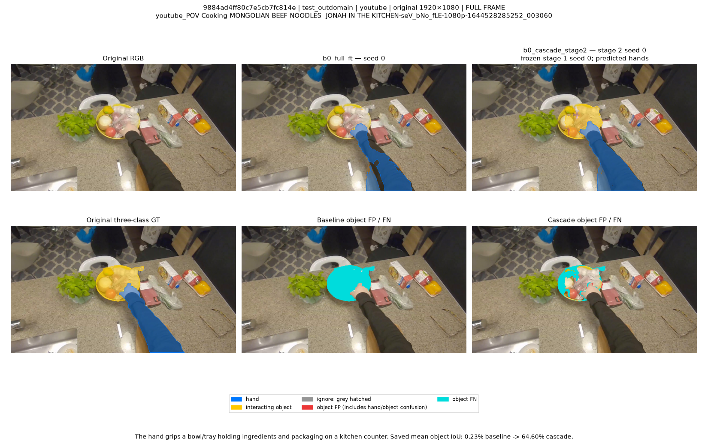
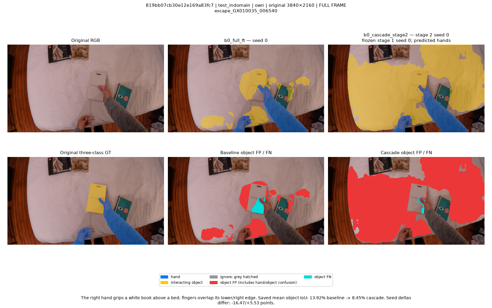
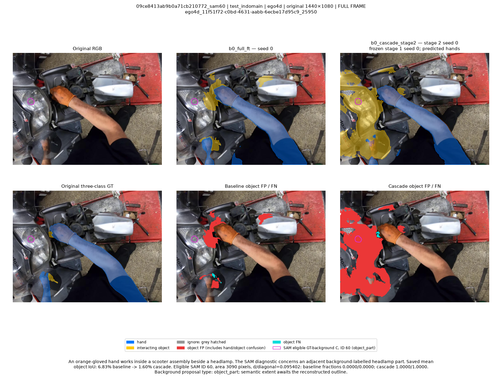
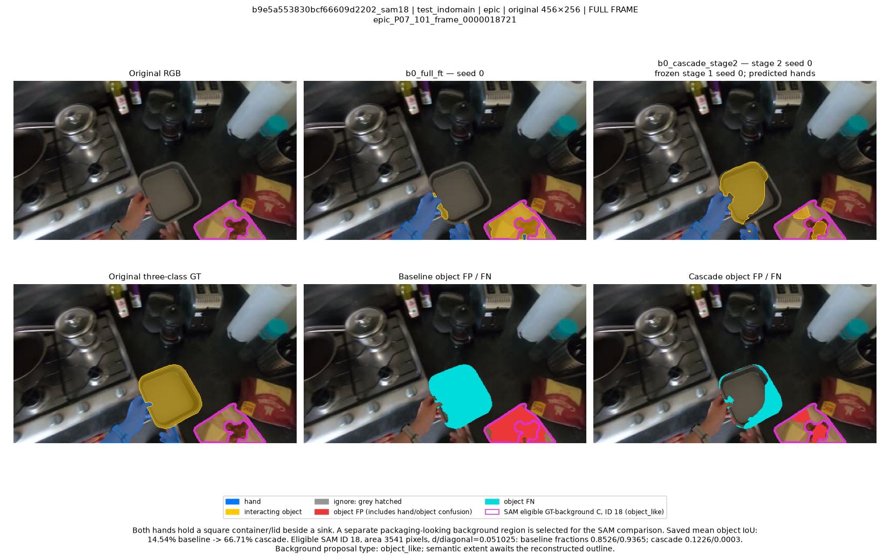

# inHand

**Hands and directly interacting objects from one egocentric RGB frame.**

inHand compares a single-stage SegFormer-B0 with a hand-guided, two-network cascade on EgoHOS. The complete cascade modestly improves mean object IoU, but **does not reduce false positives under a fixed SAM background-proposal metric**: rates increase on both test splits. The project includes training, original-resolution evaluation, reproducible analysis and visual diagnosis of successes and regressions.

PyTorch · Hugging Face Transformers · OpenCV · Modal L40S · original SAM ViT-H for measurement

## Task and data

The output is a same-size semantic mask: background, hand and directly interacting object. It identifies pixels associated with handling an object; it does not name the object or infer an action. Frames are processed independently.

| Original EgoHOS IDs | Project label | Treatment |
|---|---|---|
| 0 | 0 — background | Train and score |
| 1, 2 — left/right hand | 1 — hand | Merge sides |
| 3, 4, 5 — directly interacting objects | 2 — object | Merge left/right/both-hand associations |
| 6, 7, 8 — second-order objects | 255 — ignore | Exclude from loss and scoring |

The downloaded data contain **8,993 train / 1,124 validation / 1,126 in-domain test / 500 YouTube test** images. The two test splits total 1,626 frames. No `contact/` folders were present in this download. Data come from [EgoHOS](https://github.com/owenzlz/EgoHOS); these merged classes and the final-checkpoint protocol differ from the original paper, so the scores are not a direct benchmark comparison.

## Method

```text
Single stage: RGB ──► SegFormer-B0, 3 classes ──► background / hand / object

Cascade:      RGB ──► frozen B0 hand model ──► binary predicted hands ─┐
              RGB ─────────────────────────────────────────────────┼─► B0 object model
                                                                  │   (RGB + hand channel)
              stage-1 hands ───────────────────────────────────────┴─► compose final mask
                                                                       objects first, hands last
```

- **Baseline:** ImageNet-pretrained `nvidia/mit-b0` encoder, fresh segmentation decoder; head-only and full fine-tuning experiments. The main comparison uses two full-fine-tuning seeds.
- **Stage 1:** dedicated binary hand model, frozen seed-0 `b0_hands_only`. Object pixels become background; ignore stays excluded. Both cascade runs share this same model.
- **Stage 2:** RGB plus a binary 0/1 hand channel, predicting background/object. Clean hand pixels are background in its loss. During training, only the GT-derived hand input is corrupted with component dropping, dilation/erosion and small blobs. At inference it receives predicted hands without corruption. The extra channel's first-projection weights start at zero; pretrained RGB weights and bias are preserved. Final models reload from saved architecture and weights without repeating this surgery.
- **Composition:** paste stage-1 hands over stage-2 objects. The hand channel is a learned cue, with no hard contact or distance restriction. The oracle uses GT for both the input channel and pasted hands; its perfect hand score is by construction, and its object score is diagnostic.

Each B0 network has about **3.7M parameters**; the cascade runs **two networks** and adds compute. Full runs use 11,240 iterations, batch 16, 512×512 crops, bf16, cross-entropy ignoring 255, AdamW, 1,500 warmup iterations and polynomial decay. Encoder/head learning rates are 6e-5/6e-4. [Saved configs](results/runs/) and [reproduction details](docs/reproduction.md) specify the actual runs.

## Segmentation results

**Object IoU ×100**, pooled over valid pixels within each split, then averaged across two runs per system. These means are not prediction ensembles. Differences are computed before rounding.

| Split | Images | Full FT baseline | Predicted cascade | GT-hand oracle | Cascade − baseline, points |
|---|---:|---:|---:|---:|---:|
| Validation | 1,124 | 44.4 | 46.6 | 48.5 | +2.2 |
| In-domain test | 1,126 | 46.2 | 46.6 | 49.3 | +0.4 |
| YouTube test (`test_outdomain`) | 500 | 58.1 | 59.7 | 61.8 | +1.6 |

| Split | Object Boundary IoU, baseline → cascade | Hand IoU, baseline → cascade |
|---|---:|---:|
| Validation | 33.7 → 35.1 | 82.2 → 84.6 |
| In-domain test | 34.0 → 34.9 | 82.4 → 84.5 |
| YouTube test | 44.3 → 45.5 | 88.3 → 89.7 |

Input shorter side is 512. Logits are bilinearly upsampled in fp32 to the original label resolution (`align_corners=False`) before argmax. IoU pools confusion counts; foreground Boundary IoU pools boundary intersections/unions using a 2%-diagonal band. Final weights are reported; validation curves do not select checkpoints.

Cascade hand IoU and Boundary IoU exactly equal the shared **seed-0** hand model, rather than the two-seed hand-model average. Largest observed baseline object-IoU spread is about 0.7 points; the largest cascade spread is about 0.3. The +0.4-point in-domain gain is small relative to observed baseline variation. Two seeds establish neither significance nor a bound on future variation. There is no RGB-only binary stage-2 ablation: task heads and compute also differ, so this is a comparison of complete systems, without isolating the hand channel's effect.

Per-seed evidence: [baseline table](results/phase4_table.md), [cascade table](results/phase5_table.md), [source and pixel diagnostics](results/phase7_report.md).

## Does it reject background clutter better?

**The fixed proxy gives a negative result.** Original SAM ViT-H generated 167,652 proposals. GT filtering, ignore rejection, background clipping and mask NMS retained **102,774 shared regions**. An event occurs when **strictly more than 50%** of an eligible region is predicted as final object class 2. SAM is a measurement tool, outside the segmentation pipeline.

| Test split | Images | Shared regions | Baseline FP rate | Cascade FP rate | Change, percentage points |
|---|---:|---:|---:|---:|---:|
| In-domain | 1,126 | 68,160 | 1.15% | 1.26% | +0.11 |
| YouTube | 500 | 34,614 | 0.65% | 0.75% | +0.10 |

Rates average the two seeds; all four runs use identical denominators. Same-seed overall differences have the same direction at both seeds.



Cascade mean rates are higher in all four bins below 0.1 diagonal distance. Some farther bins favour the cascade. These are correlated proposal regions, including surfaces, clothing, parts and nested masks, rather than independently labelled untouched-object instances. No proposal-independent confidence interval was established. Higher IoU and higher region FP can coexist; increased recall or more generous masks are possible explanations, without a demonstrated causal mechanism. See the [fixed protocol](docs/phase6.md), [counts/report](results/phase6_report.md) and [original plot/data](results/clutter_fp_vs_distance.json). Phase 6 was accepted by the user; older generated report text retains its earlier pending-review wording, as recorded in [the phase log](phase.md).

## Source findings

Every object-predicting system scores higher on YouTube than on the in-domain split. Ego4D contributes **774 in-domain images and 87.14% of original in-domain frame pixels**, and has the lowest object per-image means. These source/content mixtures do not isolate domain effects or demonstrate a closed domain gap.

The model-independent **GT object-present** cohort gives the following equal-image-weighted changes. For each image, average the two same-seed cascade-minus-baseline object-IoU differences, then average images.

| Source | All test images | GT object-present | Mean paired change, points |
|---|---:|---:|---:|
| Ego4D | 774 | 714 | +1.61 |
| EPIC | 217 | 204 | +1.53 |
| THU | 88 | 77 | +2.86 |
| Authors' own videos | 47 | 42 | −0.13 |
| YouTube | 500 | 480 | +2.10 |

**These are per-image summaries, not pooled source IoUs.** No exact pooled per-source IoU or Boundary IoU pass was run; pixel-weighted image ratios cannot reconstruct them. GT object-present/absent counts are 1,037/89 in-domain and 480/20 YouTube. A GT-absent false prediction has a valid zero IoU; absent in both GT and prediction is null, never substituted with zero.



**This plot uses a different cohort from the table:** the four-run defined-score intersection. Object counts are Ego4D 754 / EPIC 212 / own 44 / THU 85 / YouTube 496. Dots are means of seed-averaged image IoUs; bars are image IQRs, not confidence intervals. [Full source audit](results/phase7/phase7_v1/verification.md).

## Four real visual examples

All prediction panels display **baseline seed 0 and cascade stage-2 seed 0**, with frozen hand-model seed 0. Layout: RGB / baseline / cascade on the top row; GT / baseline object errors / cascade object errors below. Blue = hand; yellow = object; grey hatch = ignore; red = object FP; cyan = object FN; magenta = selected eligible SAM region. Larger red areas mean more false object pixels in that image. Object errors include hand/object confusion.

**Recovery — ingredients/tray, YouTube.** Displayed seed-0 object IoU **0.47% → 67.37%**: the cascade recovers much of the foreground missed by the baseline, with misses remaining. The embedded panel's caption reports the separate **two-seed means, 0.23% → 64.60%**.

[](results/phase7/phase7_v1/gallery/9884ad4ff80c7e5cb7fc814e_full.png)

**Regression — book on a bed, authors' own video.** Displayed seed-0 object IoU **21.99% → 5.52%**: the cascade labels much more bedsheet as object despite good hand predictions. Seed 1 reverses the direction; the caption's **two-seed means are 13.92% → 8.45%**.

[](results/phase7/phase7_v1/gallery/819bb07cb30e12e169a83fc7_full.png)

**More background-region error — Ego4D headlamp part, SAM ID 60.** The selected magenta region's object fraction is **0% → 100% at both seeds**. It is a background-labelled part of a headlamp assembly; the cascade also overpredicts surrounding parts.

[](results/phase7/phase7_v1/gallery/09ce8413ab9b0a71cb210772_sam60_full.png)

**Less background-region error — EPIC packaging-looking region, SAM ID 18.** Displayed seed-0 object fraction is **85.26% → 12.26%**. Both seeds favour the cascade on this region. This remains a proposal example, without certified semantic untouched-object ground truth.

[](results/phase7/phase7_v1/gallery/b9e5a553830bcf66609d2202_sam18_full.png)

The four full panels and their matched crops are available in the [local preview page](results/phase7/phase7_v1/gallery/preview.html); GitHub displays HTML as a file, so the PNGs are embedded above. [Asset provenance](docs/assets/README.md) preserves case IDs, original names, run/seed identities and hashes. Frozen panel footers may retain pre-render wording about region review; the two displayed outlines have since been inspected in the [preview audit](results/phase7/phase7_v1/preview_review.md).

These examples were selected for diagnosis and do not estimate prevalence. The 1,626-image source analysis and 60-thumbnail RGB/GT survey are audited. **Only four of 16 selected prediction cases are rendered and checked; preview acceptance, the remaining 12 and final Phase-7 user review are pending.** This write-up does not reduce the original gallery scope or establish acceptance. Transparent-object and motion-blur categories remain uncertain.

## Reproduction

A checkout contains code and small saved outputs, **without the dataset or final weights**. Training and selected inference used Modal L40S, Volume `egohos` mounted at `/data`. Original data are `/data/egohos`, the pre-resized training copy is `/data/egohos_512/train`, and final weights are `/data/runs/<run>/model_final.pt`.

After setting up Python 3.12 with [the existing requirements](requirements.txt), the saved segmentation tables can be rebuilt locally without a GPU:

```bash
.venv/bin/python scripts/phase4_table.py --out /tmp/inhand-phase4.md
.venv/bin/python scripts/phase5_table.py --out /tmp/inhand-phase5.md
.venv/bin/python scripts/phase6_report.py --out-dir /tmp/inhand-phase6
```

[Reproduction guide](docs/reproduction.md): environment, official data acquisition and quota fallback, preprocessing, training order, evaluation/fetch, local analysis and recovery. It distinguishes inspecting existing evidence from deliberately starting new compute. No new experiments are needed to read or regenerate the available numerical results.

## Repository guide

| Location | Contents |
|---|---|
| [src/data.py](src/data.py), [src/labels.py](src/labels.py) | Torch-free data/remapping and per-run task labels |
| [src/model.py](src/model.py), [src/train.py](src/train.py), [src/evaluate.py](src/evaluate.py) | Model construction, saved architecture, training and pooled evaluation |
| [src/cascade_data.py](src/cascade_data.py), [src/cascade.py](src/cascade.py) | Hand-input corruption and composed inference |
| [configs/](configs/) | Training recipes and separate Phase-6/7 analysis configs |
| [modal_app.py](modal_app.py), [modal_data.py](modal_data.py) | GPU training/evaluation and CPU data entrypoints |
| [modal_clutter.py](modal_clutter.py), [modal_phase7.py](modal_phase7.py) | Isolated SAM measurement and selected-case workflow |
| [results/runs/](results/runs/) | Saved configs, logs, evaluation JSONs and panels; no checkpoints |
| [docs/project_explanation.md](docs/project_explanation.md) | Project pitch, design choices, metric explanations and interview guide |
| [docs/resume_bullets.md](docs/resume_bullets.md) | Defensible resume wording |
| [docs/phase8_verification.md](docs/phase8_verification.md), [phase.md](phase.md) | Documentation audit and phase/review status |

## Limits and next work

The evidence supports modest system-level IoU gains and a negative background-FP result under this proxy. Two seeds, shared stage 1, heterogeneous source mixtures, correlated SAM regions and selected qualitative cases limit interpretation. There is no temporal reasoning, object naming, action recognition, 3D or robot deployment.

Useful **unrun** experiments include an RGB-only binary object model to isolate conditioning, more seeds including independent stage-1 seeds, pooled source evaluation and a manually labelled background-object audit. ONNX/int8, controlled latency/CPU FPS, B2, temporal/video demos and robotics are future work. Training throughput is not inference FPS, and a small backbone does not establish edge readiness.

## References and publication status

- Zhang et al., **EgoHOS**, ECCV 2022: [paper](https://arxiv.org/abs/2208.03826), [official code/data entry point](https://github.com/owenzlz/EgoHOS).
- Xie et al., **SegFormer**, NeurIPS 2021: [paper](https://arxiv.org/abs/2105.15203), [official implementation](https://github.com/NVlabs/SegFormer).
- Kirillov et al., **Segment Anything**, 2023: [paper](https://arxiv.org/abs/2304.02643), [original SAM implementation](https://github.com/facebookresearch/segment-anything). This project uses original ViT-H, revision `dca509fe793f601edb92606367a655c15ac00fdf`.
- Cheng et al., **Boundary IoU**, CVPR 2021: [paper](https://arxiv.org/abs/2103.16562).

Prepared for local review. This repository has no selected project code license. Dataset-frame/panel publication rights and checkpoint redistribution remain unresolved; these local review assets do not grant reuse rights. Consult upstream terms before publication. The dataset and weights are not bundled, and no public repository, site or artifact upload is part of this phase.
